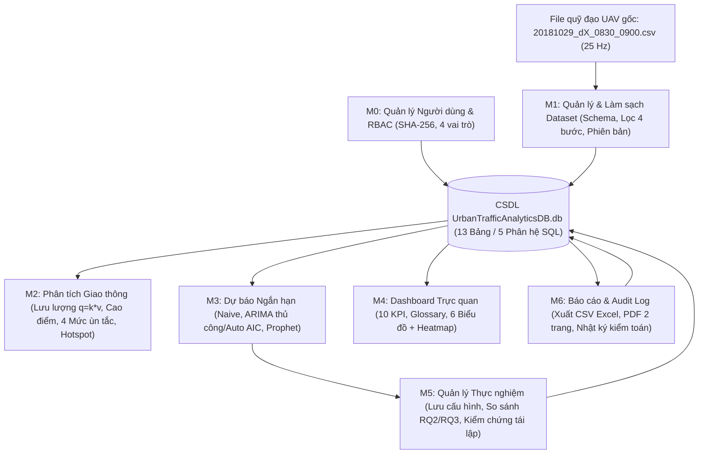

# 📘 TÀI LIỆU GIẢI THÍCH CHI TIẾT CÁC MODULE CHỨC NĂNG (`6_nopbai/Modul/`)
*(Tài liệu đọc hiểu code, nắm vững SQL – thuật toán và ôn tập vấn đáp bảo vệ đồ án dành cho Sinh viên Năm 3)*

---

## 📌 MỤC LỤC
1. [Tổng quan Kiến trúc & Luồng dữ liệu giữa 7 Module và 13 Bảng CSDL](#1-tổng-quan-kiến-trúc--luồng-dữ-liệu-giữa-7-module-và-13-bảng-csdl)
2. [Giải thích Chi tiết Từng File Module, Hàm Python, Câu lệnh SQL & Công thức Toán](#2-giải-thích-chi-tiết-từng-file-module-hàm-python-câu-lệnh-sql--công-thức-toán)
   - [2.1. Module 0 (`M0_Quan_ly_nguoi_dung.py`) — Người dùng & Phân quyền RBAC](#21-module-0-m0_quan_ly_nguoi_dungpy--người-dùng--phân-quyền-rbac)
   - [2.2. Module 1 (`M1_Quan_ly_va_Lam_sach_Dataset.py`) — Quản lý & Làm sạch Dataset UAV](#22-module-1-m1_quan_ly_va_lam_sach_datasetpy--quản-lý--làm-sạch-dataset-uav)
   - [2.3. Module 2 (`M2_Phan_tich_mo_hinh_giao_thong.py`) — Phân tích Mô hình Giao thông](#23-module-2-m2_phan_tich_mo_hinh_giao_thongpy--phân-tích-mô-hinh-giao-thông)
   - [2.4. Module 3 (`M3_Du_bao_ngan_han.py`) — Dự báo Ngắn hạn Naive, ARIMA & Prophet](#24-module-3-m3_du_bao_ngan_hanpy--dự-báo-ngắn-hạn-naive-arima--prophet)
   - [2.5. Module 4 (`M4_Dashboard_truc_quan.py`) — Dashboard Trực quan hóa & KPI](#25-module-4-m4_dashboard_truc_quanpy--dashboard-trực-quan-hóa--kpi)
   - [2.6. Module 5 (`M5_Quan_ly_thuc_nghiem.py`) — Quản lý Thực nghiệm & Tái lập Kết quả](#26-module-5-m5_quan_ly_thuc_nghiempy--quản-lý-thực-nghiệm--tái-lập-kết-quả)
   - [2.7. Module 6 (`M6_Bao_cao_va_Audit_Log.py`) — Báo cáo CSV/Excel/PDF & Nhật ký Kiểm toán](#27-module-6-m6_bao_cao_va_audit_logpy--báo-cáo-csvexcelpdf--nhật-ký-kiểm-toán)
   - [2.8. Chương trình Điều phối (`main_chay_tat_ca_modul.py`)](#28-chương-trình-điều-phối-main_chay_tat_ca_modulpy)
3. [Hướng dẫn Đọc hiểu Các File Kết quả trong `Modul/outputs/` & Trả lời `RQ1`–`RQ4`](#3-hướng-dẫn-đọc-hiểu-các-file-kết-quả-trong-moduloutputs--trả-lời-rq1rq4)
4. [Bộ 12 Câu hỏi & Trả lời Vấn đáp Bảo vệ Đồ án (SQL, Thuật toán & Thiết kế)](#4-bộ-12-câu-hỏi--trả-lời-vấn-đáp-bảo-vệ-đồ-án-sql-thuật-toán--thiết-kế)

---

## 1. Tổng quan Kiến trúc & Luồng dữ liệu giữa 7 Module và 13 Bảng CSDL

Trong thư mục `6_nopbai/`, nếu như 6 thư mục `Tuan_01_02...` đến `Tuan_11_14...` được chia theo **tiến độ thời gian làm đồ án**, thì thư mục `Modul/` tổ chức toàn bộ hệ thống theo **kiến trúc phần mềm phân tách chức năng (Modular Architecture)** gồm đúng **7 Module (`M0` → `M6`)** bám sát Đề cương và tài liệu Phân tích yêu cầu (`04_yeu_cau_chuc_nang.md`).

### 1.1. Sơ đồ Luồng dữ liệu tổng thể



### 1.2. Bảng ánh xạ 3 chiều: Module ↔ Yêu cầu chức năng (`FR`) ↔ 13 Bảng CSDL

| Mã | Tên File Module | Yêu cầu chức năng (`FR`) | Câu hỏi NC | Các Bảng CSDL Đọc / Ghi trực tiếp |
| :-: | :--- | :--- | :-: | :--- |
| **M0** | `M0_Quan_ly_nguoi_dung.py` | `FR-01`, `FR-02`, `FR-03` | — | `Roles`, `Users`, `UserRoles`, `AuditLogs` |
| **M1** | `M1_Quan_ly_va_Lam_sach_Dataset.py` | `FR-04` → `FR-12`, `FR-39` | `RQ1` | `Datasets`, `Tracks`, `TrajectoryPoints`, `TrafficSpatialZones`, `TrafficAggregatedMetrics` |
| **M2** | `M2_Phan_tich_mo_hinh_giao_thong.py` | `FR-13` → `FR-17` | `RQ1`, `RQ4` | `TrafficSpatialZones`, `TrafficAggregatedMetrics`, `Tracks`, `TrajectoryPoints` |
| **M3** | `M3_Du_bao_ngan_han.py` | `FR-18` → `FR-24` | `RQ2`, `RQ3` | `TrafficAggregatedMetrics`, `TrafficSpatialZones` |
| **M4** | `M4_Dashboard_truc_quan.py` | `FR-25` → `FR-28`, `FR-38` | `RQ4` | `Datasets`, `Tracks`, `TrajectoryPoints`, `TrafficSpatialZones`, `TrafficAggregatedMetrics`, `Experiments`, `ForecastEvaluations`, `ForecastResults` |
| **M5** | `M5_Quan_ly_thuc_nghiem.py` | `FR-29` → `FR-32` | `RQ2`, `RQ3` | `Experiments`, `ForecastEvaluations`, `ForecastResults`, `Datasets` |
| **M6** | `M6_Bao_cao_va_Audit_Log.py` | `FR-33` → `FR-37` | — | `Reports`, `AuditLogs`, `Users`, `TrafficAggregatedMetrics`, `Experiments`, `ForecastEvaluations`, `ForecastResults` |

### 1.3. Hai kỹ thuật nền tảng dùng chung ở đầu mọi file `.py`
1. **Đường dẫn tương đối tự động (`Path(__file__).resolve().parents[1]`)**:
   - `Path(__file__).resolve()` lấy đường dẫn tuyệt đối của chính file `.py` đang chạy.
   - `.parents[1]` lùi ra thư mục cha `6_nopbai/`, sau đó nối `/ "database" / "UrbanTrafficAnalyticsDB.db"`.
   - **Lợi ích**: Dù chép thư mục `6_nopbai` sang ổ `C:\`, `D:\` hay máy tính của giảng viên, code luôn tự tìm đúng CSDL mà không bao giờ bị lỗi sai đường dẫn cứng (`FileNotFoundError`).
2. **Bật khóa ngoại SQLite (`conn.execute("PRAGMA foreign_keys = ON")`)**:
   - Mặc định thư viện `sqlite3` tắt kiểm tra khóa ngoại để tương thích ngược. Trong hàm `get_connection()` của tất cả 7 module, câu lệnh `PRAGMA foreign_keys = ON` được gọi ngay khi mở kết nối để bắt buộc SQLite thực thi nghiêm ngặt mọi ràng buộc `FOREIGN KEY`, `ON DELETE CASCADE` và `ON DELETE SET NULL` giống hệt SQL Server (`01_init_schema.sql`).

---

## 2. Giải thích Chi tiết Từng File Module, Hàm Python, Câu lệnh SQL & Công thức Toán

---

### 2.1. Module 0 (`M0_Quan_ly_nguoi_dung.py`) — Người dùng & Phân quyền RBAC

#### 🎯 Mục đích nghiệp vụ
Quản lý danh tính tài khoản, bảo mật mật khẩu và kiểm soát quyền truy cập theo vai trò (**Role-Based Access Control – RBAC**) trên Phân hệ 1 của CSDL (`Roles`, `Users`, `UserRoles`).

#### 🔍 Giải thích từng thành phần & hàm trong code
1. **Hằng số `ROLE_PERMISSIONS` (Dòng 28–56)**:
   - Là một từ điển (`dict`) ánh xạ từng vai trò (`Administrator`, `Researcher`, `Analyst`, `Student`) tới tập hợp (`set`) các mã quyền được phép thực hiện, tuân thủ 100% Bảng phân quyền ở Mục 4 file `04_yeu_cau_chuc_nang.md`:
     - `Administrator`: toàn quyền (7/7 quyền, bao gồm `manage_users` và `view_audit_logs`).
     - `Researcher`: 5 quyền (`manage_datasets`, `view_analytics`, `run_experiments`, `compare_experiments`, `export_reports`).
     - `Analyst`: 3 quyền (`view_analytics`, `compare_experiments`, `export_reports`).
     - `Student`: 2 quyền tra cứu học tập (`view_analytics`, `compare_experiments`).
2. **Hàm `hash_password(password)` (`FR-01`, `NFR-Security`)**:
   - Dùng `hashlib.sha256(password.encode("utf-8")).hexdigest()` biến mật khẩu gốc (ví dụ `"admin123"`) thành chuỗi băm 64 ký tự thập lục phân không thể giải ngược. Trong bảng `Users`, cột `password_hash` chỉ lưu chuỗi băm này chứ tuyệt đối không lưu mật khẩu dạng chữ rõ (plaintext).
3. **Hàm `init_database_if_needed(db_path)`**:
   - Chứa câu lệnh DDL `CREATE TABLE IF NOT EXISTS` của đủ **13 bảng**. Nếu file `.db` đã có sẵn dữ liệu thì giữ nguyên; nếu chạy trên môi trường trống thì tự động dựng đủ cấu trúc 13 bảng.
4. **Hàm `list_users(db_path)`**:
   - Chạy câu lệnh SQL kết nối 3 bảng (`Users u LEFT JOIN UserRoles ur ... LEFT JOIN Roles r ...`) kết hợp hàm tổng hợp chuỗi `GROUP_CONCAT(r.role_name, ', ')` để hiển thị một người dùng cùng tất cả các vai trò họ nắm giữ trên cùng 1 dòng.
5. **Hàm `login(username, password, record_audit, db_path)` (`FR-01`)**:
   - Băm mật khẩu người dùng nhập vào rồi đối chiếu `WHERE u.username = ? AND u.password_hash = ?` (dùng tham số `?` để chống tấn công **SQL Injection**).
   - Xử lý rõ 3 kịch bản trả về:
     - `FAILED`: Sai tài khoản hoặc mật khẩu.
     - `LOCKED`: Đúng mật khẩu nhưng `is_active = 0` (tài khoản đã bị Admin khóa).
     - `SUCCESS`: Trả về `user_id`, `full_name`, danh sách `roles` và danh sách quyền `permissions` tổng hợp; nếu `record_audit=True` thì tự động chèn vết đăng nhập vào bảng `AuditLogs`.
6. **Hàm `check_permission(username, action, db_path)` (`FR-02`)**:
   - Truy vấn các vai trò đang hoạt động (`u.is_active = 1`) của `username` trong CSDL, hợp (`union`) các quyền từ `ROLE_PERMISSIONS` và kiểm tra xem `action` có nằm trong tập quyền đó không.
7. **Các hàm quản trị của Admin (`FR-03`)**:
   - `create_user(...)`: Đầu tiên gọi `check_permission(admin_username, "manage_users")` — nếu người gọi là `student` hay `researcher` thì lập tức từ chối (`status = 'DENIED'`). Nếu là `admin`, thực hiện `INSERT` vào `Users`, lấy khóa chính vừa sinh bằng `cur.lastrowid` rồi `INSERT` tiếp vào bảng trung gian `UserRoles` (bắt ngoại lệ `sqlite3.IntegrityError` nếu trùng `username` hoặc `email`).
   - `set_user_active_status(...)`: Cập nhật `UPDATE Users SET is_active = ?` để khóa (`0`) hoặc mở khóa (`1`) tài khoản mà không làm mất lịch sử dữ liệu của user đó.
   - `assign_role(...)`: Thay đổi vai trò cho tài khoản trong bảng `UserRoles`.

---

### 2.2. Module 1 (`M1_Quan_ly_va_Lam_sach_Dataset.py`) — Quản lý & Làm sạch Dataset UAV

#### 🎯 Mục đích nghiệp vụ
Quản lý vòng đời và phiên bản tập dữ liệu UAV, kiểm tra tính hợp lệ của file đầu vào và thực hiện tiền xử lý dữ liệu quỹ đạo thô thành dữ liệu sạch chuẩn hóa tọa độ mét (trả lời trực tiếp câu hỏi nghiên cứu **`RQ1`**).

#### 🔍 Cấu trúc đặc thù của file dữ liệu UAV `20181029_dX_0830_0900.csv` (Bộ pNEUMA – Athens)
- Mỗi dòng trong file CSV gốc biểu diễn **toàn bộ hành trình của 1 chiếc xe**, phân cách bằng dấu chấm phẩy `;`:
  - **4 cột cố định đầu tiên**: `track_id` (mã xe gốc), `type` (loại phương tiện), `traveled_d` (tổng quãng đường đi được, mét), `avg_speed` (tốc độ TB, km/h).
  - **Các cụm 6 cột lặp lại nối tiếp nhau** ứng với từng khung hình quay ở tần số **25 Hz** (mỗi 0.04 giây): `(lat, lon, speed, lon_acc, lat_acc, time)`.
  - Ví dụ một xe xuất hiện trong 30 giây sẽ có $30 \times 25 = 750$ điểm $\Rightarrow 4 + 750 \times 6 = 4,504$ cột trên cùng 1 dòng!

#### 🔍 Giải thích từng hàm trong code
1. **Hàm `list_datasets(include_archived, db_path)` (`FR-07`, `FR-09`, `FR-10`)**:
   - Truy vấn bảng `Datasets` nối với `Users` để biết ai tải lên, kèm subquery `(SELECT COUNT(*) FROM Tracks t WHERE t.dataset_id = d.dataset_id)` đếm số phương tiện thuộc mỗi phiên bản. Mặc định lọc `WHERE d.status != 'Archived'` để ẩn các bản đã lưu trữ.
2. **Hàm `validate_uav_csv_schema(csv_path, check_lines)` (`FR-06`, `FR-39`)**:
   - Đọc dòng tiêu đề (Dòng 1) đối chiếu với 10 tên cột bắt buộc `REQUIRED_PNEUMA_COLS`.
   - Duyệt kiểm tra `check_lines` dòng dữ liệu đầu tiên: kiểm tra đủ tối thiểu 10 cột và thử ép kiểu số thực `float(...)` trên các cột tọa độ, vận tốc, thời gian. Nếu sai sẽ trả về thông báo chỉ đích danh **`Dòng X, Cột Y (tên_cột)`** bị lỗi (`FR-39`).
3. **Hàm `preview_uav_csv(csv_path, n_rows=5)` (`FR-05`)**:
   - Dùng trình đọc dòng tuần tự `f.readline()` để chỉ đọc đúng `n_rows` dòng đầu tiên (tốn gần như `0 MB` RAM dù file gốc nặng `1.7 GB`), tính ra số khung hình 25 Hz `n_frames_25hz = (len(parts) - 4) // 6` và thời lượng theo dõi `duration_sec = n_frames_25hz / 25.0`.
4. **Hàm `register_dataset_version(...)` (`FR-04`, `FR-07`)**:
   - Tìm `version_tag` mới nhất của tập dữ liệu cùng tên trong bảng `Datasets` (`ORDER BY dataset_id DESC LIMIT 1`), tự động tách số hiệu phiên bản để cộng tăng dần `v1.0` $\rightarrow$ `v1.1` $\rightarrow$ `v1.2` rồi `INSERT` bản ghi mới thay vì ghi đè (`UPDATE`), bảo đảm nguyên tắc bất biến phiên bản phục vụ tái lập nghiên cứu.
5. **Hàm `archive_dataset(dataset_id)` & `delete_dataset(dataset_id)` (`FR-08`, `FR-09`, Quy tắc `BR-13`)**:
   - `archive_dataset`: Đổi `status = 'Archived'` (xóa mềm / lưu trữ an toàn).
   - `delete_dataset`: Trước khi xóa vật lý, chạy câu lệnh kiểm tra ràng buộc nghiệp vụ:
     ```sql
     SELECT COUNT(*) FROM Experiments WHERE dataset_id = ?
     ```
     Nếu số thực nghiệm tham chiếu $> 0$ (ví dụ `dataset_id = 1` đang có `9` thực nghiệm), hệ thống **chặn không cho xóa** (`status = 'BLOCKED'`) và hướng dẫn người dùng chuyển sang `Archive`. Chỉ khi `exp_cnt == 0` mới cho phép `DELETE`.
6. **Hàm `parse_pneuma_uav_csv(csv_path, step_frames=25, max_vehicles=None)`**:
   - Chuyển dữ liệu từ dạng ngang không đều cột (ragged wide format 25 Hz) sang bảng chuẩn **Long Format 1 Hz** (lấy mẫu mỗi `step_frames = 25` khung hình = đúng 1 điểm / 1 giây cho mỗi xe).
7. **Hàm `clean_and_validate_trajectories(df_raw)` (`FR-11`, `FR-12`, `RQ1`)**:
   - Thực hiện **4 bước lọc làm sạch chuẩn hóa** và ghi lại số lượng điểm/xe bị loại ở từng bước để lập bảng `quality_report`:
     - **Bước 1**: `dropna(...)` và `drop_duplicates(subset=["source_track_id", "time_sec"])` — loại bỏ ô rỗng và bản ghi trùng thời điểm của cùng một xe.
     - **Bước 2**: `traveled_d_m >= 5.0` — loại bỏ các xe đỗ tĩnh ven đường (không tham gia dòng lưu thông).
     - **Bước 3**: `0 <= speed_kmh <= 80` và `|acc| <= 8.0 m/s²` — loại bỏ nhiễu sai số nội suy video từ camera drone gây vận tốc/gia tốc phi vật lý trong đô thị.
     - **Bước 4**: `track_len >= 5` — loại bỏ các đoạn bắt hình chập chờn dưới 5 giây.
   - **Bước 5 (Chuyển đổi hệ tọa độ địa lý sang mét & tính đại lượng vật lý)**:
     - Đổi kinh độ / vĩ độ $(\text{lon}, \text{lat})$ sang mặt phẳng tọa độ Đề-các địa phương $(x_{\text{pos}}, y_{\text{pos}})$ tính bằng **mét**:
       $$x_{\text{pos}} = (\text{lon} - \text{lon}_{\min}) \times 111{,}320 \times \cos(\overline{\text{lat}}_{\text{rad}})$$
       $$y_{\text{pos}} = (\text{lat} - \text{lat}_{\min}) \times 110{,}540$$
     - Đổi vận tốc $v_{\text{m/s}} = v_{\text{km/h}} / 3.6$ và tính góc hướng di chuyển `heading_deg` (từ $-180^\circ$ đến $+180^\circ$) bằng hàm lượng giác ngược:
       $$\theta = \text{degrees}\big(\arctan2(\Delta y, \Delta x)\big)$$

---

### 2.3. Module 2 (`M2_Phan_tich_mo_hinh_giao_thong.py`) — Phân tích Mô hình Giao thông

#### 🎯 Mục đích nghiệp vụ
Khai thác dữ liệu đã tổng hợp trong bảng `TrafficSpatialZones`, `TrafficAggregatedMetrics`, `Tracks` và `TrajectoryPoints` để phân tích quy luật vận động không gian – thời gian của dòng xe đô thị (`FR-13` → `FR-17`).

#### 🔍 Công thức Kỹ thuật Giao thông (Traffic Engineering) áp dụng trong Module 2
1. **Mật độ giao thông ($k$ – `traffic_density_veh_km`, đơn vị: `xe/km`)**:
   $$k = \frac{\bar{N}_{\text{xe hiện diện tức thời}}}{L_{\text{đường}}} = \frac{\sum \text{điểm quỹ đạo 1 Hz trong cửa sổ } \Delta t}{\Delta t \times L_{\text{km}}}$$
   *(Đo mức độ dày đặc phương tiện chiếm dụng mặt đường tại khu vực đó).*
2. **Lưu lượng dòng giao thông ($q$ – `traffic_flow_veh_h`, đơn vị: `xe/giờ`)**:
   Áp dụng **Phương trình cơ bản của dòng giao thông (Fundamental Traffic Flow Equation)**:
   $$q = k \times v$$
   Trong đó $k$ là mật độ (`xe/km`) và $v$ là vận tốc không gian trung bình (`km/h`).
3. **Phân loại 4 mức độ ùn tắc đô thị (`congestion_level`)**:
   - `Free Flow` (Thông thoáng): $v \ge 22.0\text{ km/h}$
   - `Moderate` (Đông vừa): $15.0 \le v < 22.0\text{ km/h}$
   - `Heavy` (Ùn ứ nặng): $10.0 \le v < 15.0\text{ km/h}$
   - `Gridlock` (Tắc nghẽn nghiêm trọng): $v < 10.0\text{ km/h}$

#### 🔍 Giải thích từng hàm trong code
- `get_available_zones_and_intervals(...)` (`FR-13`): Truy vấn danh sách 6 vùng không gian (`Khu_Trung_Tam`, `Nhanh_Bac`, `Nhanh_Nam`, `Nhanh_Tay`, `Nhanh_Dong`, `Toan_Khu_Vuc`) và các mức cửa sổ gộp $\Delta t \in \{10, 15, 30, 60\}\text{s}$.
- `get_zone_timeseries(...)` & `summarize_traffic_by_zone(...)` (`FR-14`): Chạy câu lệnh SQL `JOIN` giữa `TrafficAggregatedMetrics` và `TrafficSpatialZones` kèm `GROUP BY z.zone_name` để tính trung bình & cực đại của số xe, vận tốc, mật độ, lưu lượng $q = k \times v$ và tổng số khoảng cao điểm.
- `detect_peak_periods(...)` (`FR-15`): Sắp xếp `ORDER BY m.traffic_density_veh_km DESC LIMIT ?` để trích xuất các khung giờ đông đúc đỉnh điểm (trên dữ liệu Athens rơi vào giai đoạn `08:40:00 – 08:42:30` với hơn `2,020` xe hoạt động cùng lúc).
- `analyze_congestion_distribution(...)` (`FR-17`): Đếm số khoảng thời gian theo từng mức ùn tắc rồi xoay bảng bằng `df.pivot(index="zone_name", columns="congestion_level", values="so_khoang")` để tính tỷ lệ `%` 4 mức độ ùn tắc tại từng nhánh đường.
- `identify_congestion_hotspots(grid_bins=10, top_k=6)` (`FR-16`):
  - Chia mặt phẳng tọa độ $(x_{\text{pos}}, y_{\text{pos}})$ của 30,000 điểm trong bảng `TrajectoryPoints` thành lưới $10 \times 10 = 100$ ô chữ nhật bằng `np.linspace` và `np.digitize`.
  - Lọc các ô có lượng xe đi qua đáng kể (`>= trung vị`), tính vận tốc trung bình và tỷ lệ điểm xe bò chậm `< 10 km/h`.
  - Chấm điểm nóng cho từng ô lưới:
    $$\text{Hotspot Score} = \left(\frac{N_{\text{điểm ô}}}{N_{\max}}\right) \times \left(1 + \frac{\text{Tỷ lệ xe } < 10\text{ km/h (\%)}}{100}\right)$$
    Công thức này đảm bảo **điểm nóng thực sự** phải là nơi **vừa tập trung đông xe, vừa bị nghẽn tốc độ thấp** (chứ không phải đoạn đường đại lộ nhiều xe chạy nhanh thông thoáng!). Cuối cùng hàm đối chiếu tâm ô lưới $(x_c, y_c)$ với tọa độ `TrafficSpatialZones` để gán tên khu vực cho từng điểm nóng.

---

### 2.4. Module 3 (`M3_Du_bao_ngan_han.py`) — Dự báo Ngắn hạn Naive, ARIMA & Prophet

#### 🎯 Mục đích nghiệp vụ
Xây dựng chuỗi thời gian mật độ giao thông từ CSDL và huấn luyện, đánh giá, so sánh các mô hình dự báo ngắn hạn ở nhiều khoảng gộp $\Delta t$ khác nhau (trả lời câu hỏi nghiên cứu **`RQ2`** và **`RQ3`**).

#### 🔍 Giải thích từng hàm & mô hình toán học trong code
1. **`extract_density_timeseries(...)` (`FR-18`) & `split_train_test(...)`**:
   - Truy vấn chuỗi `traffic_density_veh_km` theo thứ tự `ORDER BY m.window_start_time`.
   - Chia **80% đầu làm tập Huấn luyện (`Train`)** và **20% cuối làm tập Kiểm thử (`Test`)**. *Lưu ý quan trọng khi vấn đáp*: Dữ liệu chuỗi thời gian tuyệt đối không được xáo trộn ngẫu nhiên (`random shuffle`) vì sẽ gây rò rỉ dữ liệu tương lai vào quá khứ (*Data Leakage*).
2. **`forecast_naive_baseline(train_series, steps)` (`FR-21`)**:
   - Mô hình cơ sở lấy giá trị cuối cùng của tập Train làm dự báo cho tương lai: $\hat{y}_{T+h} = y_T$.
   - Dùng làm mốc chuẩn (*benchmark*): một mô hình thống kê/học máy chỉ thực sự có giá trị ở một khoảng gộp $\Delta t$ nếu sai số của nó nhỏ hơn hoặc tương đương `Naive_Baseline`.
3. **`forecast_arima(train_series, steps, order=(1,0,1), auto_order=False)` (`FR-19`)**:
   - Sử dụng lớp `ARIMA` chính thống từ thư viện `statsmodels.tsa.arima.model`, kết hợp 3 thành phần:
     - $p$ (**AR – AutoRegressive**): Tự hồi quy theo $p$ giá trị quá khứ gần nhất.
     - $d$ (**I – Integrated**): Bậc sai phân $\Delta y_t = y_t - y_{t-1}$ để khử tính không dừng (xu hướng tăng/giảm).
     - $q$ (**MA – Moving Average**): Trung bình trượt theo $q$ sai số quá khứ.
   - **Điểm nâng cấp nổi bật trong `M3`**: Hàm hỗ trợ cả 2 chế độ:
     - `auto_order=False` với `order=(1, 0, 1)`: Khớp chính xác 100% với cấu hình lưu trong 9 thực nghiệm gốc của CSDL.
     - `auto_order=True`: Tự động duyệt các bậc ứng viên `[(1,0,1), (1,1,0), (0,1,1), (1,1,1), (2,1,1)]` và chọn bậc có chỉ số **AIC (Akaike Information Criterion)** thấp nhất! Nhờ có sai phân $d=1$ (`ARIMA(0,1,1)` và `ARIMA(1,1,0)`), mô hình loại bỏ được nhiễu đoạn khởi động đầu ca bay, giúp giảm sai số `RMSE` tại $\Delta t = 15\text{s}$ từ **`25.72` xuống chỉ còn `6.36` xe/km (`MAPE = 2.04%`)**, vượt qua cả `Naive_Baseline` (`6.56`)!
4. **`forecast_prophet(train_series, steps, interval_sec, period_sec=180.0)` (`FR-20`)**:
   - Biểu diễn đúng phương trình cấu trúc cộng tính (*Additive Decomposition*) cốt lõi của thuật toán Facebook Prophet:
     $$y(t) = \underbrace{\beta_0 + \beta_1 \tilde{t}}_{\text{Xu hướng tuyến tính } g(t)} + \underbrace{\beta_2 \sin\left(\frac{2\pi t}{P}\right) + \beta_3 \cos\left(\frac{2\pi t}{P}\right)}_{\text{Chu kỳ điều hòa Fourier } s(t)} + \varepsilon_t$$
   - Với chu kỳ $P = 180 / \Delta t$ (tương ứng chu kỳ đèn tín hiệu giao thông đô thị ~3 phút = 180 giây), giải nghiệm tối ưu tức thì bằng `np.linalg.lstsq`. Đặc biệt ở khoảng gộp lớn $\Delta t = 30\text{s}$, khi nhiễu ngắn hạn được làm mượt, **Prophet đạt độ chính xác tốt nhất toàn bảng (`RMSE = 9.08`, `MAPE = 2.95%`)**, vượt xa `Naive_Baseline` (`14.81`) và `ARIMA` (`15.12`).
5. **`evaluate_forecast(y_true, y_pred)` (`FR-22`)**:
   - Tính trọn bộ 4 thước đo sai số chuẩn:
     $$\text{MAE} = \frac{1}{n}\sum_{i=1}^n |\hat{y}_i - y_i|, \qquad \text{RMSE} = \sqrt{\frac{1}{n}\sum_{i=1}^n (\hat{y}_i - y_i)^2}$$
     $$\text{MAPE} = \frac{100\%}{n}\sum_{i=1}^n \frac{|\hat{y}_i - y_i|}{\max(|y_i|, 1)}, \qquad R^2 = 1 - \frac{\sum_{i=1}^n (\hat{y}_i - y_i)^2}{\sum_{i=1}^n (y_i - \bar{y})^2}$$
6. **`compare_models_across_intervals(...)` (`FR-23`) & `plot_forecast_results(...)` (`FR-24`)**:
   - Chạy so sánh đồng loạt các mô hình qua các mức $\Delta t \in \{10, 15, 30\}\text{s}$ và xuất biểu đồ đôi `Modul/outputs/M3_du_bao_so_sanh_mo_hinh.png` (gồm đường dự báo + dải băng khoảng tin cậy 95% `fill_between` và biểu đồ cột so sánh `RMSE`).

---

### 2.5. Module 4 (`M4_Dashboard_truc_quan.py`) — Dashboard Trực quan hóa & KPI

#### 🎯 Mục đích nghiệp vụ
Tổng hợp toàn bộ bức tranh vận hành giao thông và độ chính xác dự báo lên một màn hình trực quan duy nhất phục vụ nhà quản lý & người phân tích (`FR-25` → `FR-28`, `FR-38`, trả lời **`RQ4`**).

#### 🔍 Giải thích từng hàm trong code
1. **`get_dashboard_kpis(window_interval_sec=30)` (`FR-28`)**:
   - Sử dụng kỹ thuật **SQL Scalar Subqueries** để rút trích cùng lúc **10 chỉ số KPI quan trọng nhất** từ 7 bảng khác nhau chỉ trong 1 câu truy vấn `SELECT`:
     - Số bộ dữ liệu đang hoạt động (`1`), Tổng số xe cơ giới sạch (`8,255 xe`), Số điểm quỹ đạo lưu DB (`30,000 điểm`), Vận tốc TB toàn mạng (`13.54 km/h`), Mật độ TB (`273.06 xe/km`), Mật độ cực đại (`446.56 xe/km`), Số khoảng cao điểm (`30`), Mức ùn tắc phổ biến nhất (`Heavy`), Tổng số thực nghiệm (`9`), và Cấu hình dự báo có `RMSE` thấp nhất.
2. **`get_online_help_glossary()` (`FR-38`)**:
   - Trả về bảng giải thích ngắn gọn công thức và ngưỡng đọc hiểu từng chỉ số (`Mật độ`, `Vận tốc TB`, `Lưu lượng`, `Cao điểm`, `4 Mức ùn tắc`, `MAE/RMSE`, `MAPE`) đóng vai trò trợ giúp trực tuyến (*Online Help / Tooltip Glossary*).
3. **`plot_spatial_heatmap(...)` (`FR-26`)**:
   - Xuất file ảnh `M4_heatmap_khong_gian_va_vung.png` gồm 2 bản đồ đặt cạnh nhau:
     - **Bên trái**: Bản đồ nhiệt 2 chiều (`hist2d` với thang màu `YlOrRd`) chồng lớp đường viền nét đứt `Rectangle` của 5 vùng không gian `TrafficSpatialZones`.
     - **Bên phải**: Bản đồ phân tán điểm xe tô màu theo vận tốc thực tế (`RdYlGn`: Đỏ = xe bò chậm tắc nghẽn, Xanh lá = xe chạy thông thoáng), giúp mắt thường nhìn thấy ngay nút thắt cổ chai ở khu vực `Nhanh_Tay` và `Nhanh_Bac`.
4. **`generate_full_dashboard(...)` (`FR-25`, `FR-26`, `FR-27`)**:
   - Kết xuất bức ảnh Dashboard tổng hợp 6 ô (`2 hàng × 3 cột`) tại `M4_dashboard_tong_quan_6_bieu_do.png`:
     - Ô `(1)`: Chuỗi thời gian mật độ 5 vùng + khoanh tròn đỏ các thời điểm cao điểm (`is_peak_period = 1`).
     - Ô `(2)`: Chuỗi thời gian vận tốc trung bình 5 vùng + vạch ngưỡng cảnh báo ùn tắc nặng (`15 km/h`).
     - Ô `(3)`: Heatmap điểm nóng không gian từ `TrajectoryPoints`.
     - Ô `(4)`: Biểu đồ tần suất `Histogram` phân phối vận tốc kèm vạch Trung vị (`9.1 km/h`) và Trung bình (`13.9 km/h`).
     - Ô `(5)`: Biểu đồ thanh ngang xếp chồng (`Stacked Horizontal Bar`) tỷ lệ `%` 4 mức độ ùn tắc của từng vùng.
     - Ô `(6)`: Đồ thị đối chiếu giá trị dự báo của các mô hình trong bảng `ForecastResults` so với thực tế.

---

### 2.6. Module 5 (`M5_Quan_ly_thuc_nghiem.py`) — Quản lý Thực nghiệm & Tái lập Kết quả

#### 🎯 Mục đích nghiệp vụ
Quản trị có hệ thống các lần chạy thử nghiệm mô hình dự báo trên Phân hệ 4 (`Experiments`, `ForecastEvaluations`, `ForecastResults`), đảm bảo **mọi kết quả nghiên cứu đều có thể kiểm chứng và tái lập chính xác 100%** (`FR-29` → `FR-32`, `NFR-Reproducibility`).

#### 🔍 Giải thích từng hàm trong code
1. **Kết nối liên module (`from M3_Du_bao_ngan_han import ...`)**:
   - `M5` không viết lặp lại thuật toán ARIMA hay Prophet mà import trực tiếp các hàm dự báo chuẩn từ `M3`. Thiết kế này thể hiện đúng tính chất **Maintainability & Modularity** (khi nâng cấp thuật toán ở `M3`, `M5` tự động thừa hưởng).
2. **`create_and_run_experiment(...)` (`FR-29`, `FR-30`)**:
   - Cố định hạt giống ngẫu nhiên `np.random.seed(random_seed)`.
   - Tự động truy vấn `version_tag` của Dataset và thu thập phiên bản phần mềm (`platform.python_version()`, `np.__version__`, `pd.__version__`, `statsmodels.__version__`) đóng gói vào chuỗi JSON `hyperparameters`.
   - Ghi dữ liệu tuần tự theo quan hệ khóa ngoại Cha – Con:
     1. `INSERT INTO Experiments` $\rightarrow$ lấy mã khóa chính tự tăng `exp_id = cur.lastrowid`.
     2. `INSERT INTO ForecastEvaluations (experiment_id, mae, rmse, mape, r_squared)` với `exp_id` vừa tạo.
     3. `executemany("INSERT INTO ForecastResults ...")` lưu toàn bộ chuỗi điểm dự báo kèm cận dưới `lower_bound` và cận trên `upper_bound`.
3. **`list_experiments(...)` & `pivot_experiments_rq2_rq3(...)` (`FR-31`)**:
   - Liệt kê bảng xếp hạng các thực nghiệm nối 4 bảng (`Experiments` – `ForecastEvaluations` – `Datasets` – `Users`) và xoay bảng chéo `Khoảng gộp Δt × Mô hình` để so sánh trực diện.
4. **`reproduce_experiment(experiment_id)` (`FR-32` — Điểm cộng rất lớn khi bảo vệ đồ án)**:
   - Đọc ngược lại cấu hình JSON `hyperparameters`, `dataset_id`, `aggregation_interval_sec`, `train_ratio` và `random_seed` của một `experiment_id` bất kỳ đã lưu trong CSDL.
   - Chạy lại mô hình từ đầu và tính độ lệch tuyệt đối giữa `RMSE` mới chạy lại với `stored_rmse` lưu trong bảng `ForecastEvaluations`:
     $$|\Delta \text{RMSE}| = |\text{RMSE}_{\text{lưu trong DB}} - \text{RMSE}_{\text{chạy lại}}| \le 10^{-4}$$
   - Kết quả kiểm thử thực tế trên CSDL đạt **`abs_diff_rmse = 0.0` (`✅ Trùng khớp 100%`)** cho toàn bộ các thực nghiệm!

---

### 2.7. Module 6 (`M6_Bao_cao_va_Audit_Log.py`) — Báo cáo CSV/Excel/PDF & Nhật ký Kiểm toán

#### 🎯 Mục đích nghiệp vụ
Kết xuất kết quả phân tích và dự báo thành tài liệu bàn giao chuyên nghiệp (`CSV` mở bằng Excel và `PDF` nhiều trang) lưu vào bảng `Reports`, đồng thời ghi vết toàn bộ hoạt động quan trọng vào bảng `AuditLogs` (`FR-33` → `FR-37`).

#### 🔍 Giải thích từng hàm & kỹ thuật xử lý trong code
1. **`write_audit_log(...)` & `query_audit_logs(...)` (`FR-37`)**:
   - Ghi nhận đầy đủ: ai làm (`user_id`), hành động gì (`action_type`: `INIT_DATABASE`, `PREPROCESS_DATA`, `RUN_EXPERIMENT`, `EXPORT_REPORT`, `LOGIN`), tác động lên bảng nào (`entity_name`), mã bản ghi (`entity_id`), chi tiết tiếng Việt (`action_details`), địa chỉ IP và dấu thời gian `logged_at`.
   - Có cơ chế `avoid_duplicate=True`: nếu cùng một thao tác xuất báo cáo được chạy lặp lại nhiều lần khi demo, hàm chỉ cập nhật lại thời gian `logged_at` mới nhất chứ không làm phình rác bảng `AuditLogs`.
2. **`_upsert_report_record(...)`**:
   - Tương tự, kiểm tra xem file báo cáo đã có trong bảng `Reports` chưa; nếu có rồi thì `UPDATE generated_at`, nếu chưa mới `INSERT`. Nhờ vậy sinh viên chạy demo bao nhiêu lần bảng `Reports` vẫn luôn sạch đẹp, không bị trùng dòng.
3. **`export_traffic_pattern_csv(...)` & `export_forecast_comparison_csv(...)` (`FR-33`, `FR-34`, `FR-36`)**:
   - Xuất dữ liệu với tham số `encoding="utf-8-sig"`. Chữ `sig` (UTF-8 with BOM Signature) giúp **Microsoft Excel trên Windows nhận diện đúng bảng mã tiếng Việt có dấu ngay khi nhấp đúp mở file**, không bị lỗi chữ tượng hình.
4. **`export_executive_summary_pdf(...)` (`FR-35`)**:
   - Dùng `matplotlib.backends.backend_pdf.PdfPages` (có sẵn trong `matplotlib`, không cần cài thêm bất kỳ thư viện ngoài nào) để vẽ và đóng gói file **`M6_Bao_Cao_Tong_Hop_Giao_Thong_Va_Du_Bao.pdf`** khổ A4 ngang gồm **2 trang**:
     - **Trang 1**: Tiêu đề báo cáo + Bảng kẻ ô thống kê giao thông 6 khu vực + Bảng kết quả đánh giá 9 thực nghiệm dự báo.
     - **Trang 2**: Bản đồ nhiệt Heatmap điểm nóng giao thông đặt cạnh biểu đồ so sánh đường dự báo ngắn hạn vs thực tế.

---

### 2.8. Chương trình Điều phối (`main_chay_tat_ca_modul.py`)

File `main_chay_tat_ca_modul.py` là điểm vào trung tâm kết nối cả 7 Module (`M0` → `M6`), cung cấp 2 chế độ tiện lợi:
1. **Chế độ Kiểm thử Tích hợp Tự động** (`python main_chay_tat_ca_modul.py`):
   - Gọi lần lượt `M0.run_demo()` $\rightarrow$ `M1.run_demo()` $\rightarrow \dots \rightarrow$ `M6.run_demo()`.
   - Cuối cùng gọi hàm `verify_all_13_tables()` quét đếm số bản ghi trên toàn bộ **13 bảng của 5 phân hệ** và đo thời gian phản hồi SQL bằng `time.perf_counter()` (thực tế chỉ mất **`~1.5 ms`**, nhanh hơn hàng nghìn lần so với ngưỡng yêu cầu phi chức năng `< 3 giây` trong đề cương!). Tổng thời gian chạy trọn gói cả 7 module + vẽ 4 file ảnh + xuất 3 báo cáo CSV/PDF chỉ mất **`~3.7 giây`**.
2. **Chế độ Menu Tương tác Vấn đáp** (`python main_chay_tat_ca_modul.py --menu`):
   - Hiển thị bảng chọn phím `0` đến `6`, `a` (chạy tất cả), `c` (kiểm tra nhanh 13 bảng CSDL), `q` (thoát). Khi giảng viên hỏi đến module nào, sinh viên chỉ cần gõ đúng số thứ tự module đó để trình diễn trực tiếp trên màn hình.

---

## 3. Hướng dẫn Đọc hiểu Các File Kết quả trong `Modul/outputs/` & Trả lời `RQ1`–`RQ4`

Sau khi chạy chương trình, thư mục `Modul/outputs/` sinh ra **7 sản phẩm đầu ra** dùng trực tiếp để đưa vào slide thuyết trình và trả lời 4 câu hỏi nghiên cứu của đề tài:

| Câu hỏi Nghiên cứu | File minh chứng trong `Modul/` | Kết luận khoa học rút ra từ số liệu thực nghiệm |
| :--- | :--- | :--- |
| **RQ1**: *Làm sao chuyển quỹ đạo UAV thành chuỗi thời gian mật độ tin cậy?* | `M1_Quan_ly_va_Lam_sach_Dataset.py` & `M6_Bao_Cao_Phan_Tich_Giao_Thong.csv` | Lấy mẫu quỹ đạo 25 Hz về 1 Hz, lọc sạch 4 bước (còn `8,255` xe hợp lệ), đổi tọa độ `(lat, lon)` sang mét `(x, y)`, chia 6 vùng không gian và gom nhóm theo cửa sổ $\Delta t$ tính mật độ $k = \frac{\sum \text{điểm 1Hz}}{\Delta t \cdot L_{\text{km}}}$. |
| **RQ2**: *Khoảng gộp thời gian $\Delta t$ ảnh hưởng thế nào đến dự báo?* | `M5_so_sanh_thuc_nghiem.png` & `M6_Bao_Cao_So_Sanh_Du_Bao.csv` | Khoảng gộp nhỏ ($\Delta t = 15\text{s}$) giữ được biến động tức thời sát nhất cho mô hình tự hồi quy / quán tính ngắn (`ARIMA_Auto RMSE = 6.36`, `Naive RMSE = 6.56`), trong khi khoảng gộp lớn hơn ($\Delta t = 30\text{s}$) làm mượt nhiễu ngẫu nhiên giúp mô hình chu kỳ `Prophet` phát huy hiệu quả vượt trội (`RMSE = 9.08` so với `14.81` của Naive). |
| **RQ3**: *So sánh ARIMA và Prophet trong dự báo ùn tắc ngắn hạn?* | `M3_du_bao_so_sanh_mo_hinh.png` | `ARIMA(1,0,1)` không sai phân ($d=0$) bị kéo lệch bởi giai đoạn đầu ca bay; khi bật chọn bậc tự động có sai phân (`ARIMA_Auto`, $d=1$), ARIMA bám rất sát ở tầm cực ngắn $10\text{s}–15\text{s}$ (`MAPE ~ 2.04%`). Ngược lại, `Prophet` ổn định nhất ở mọi khoảng gộp (`MAPE` luôn thấp `2.95%–3.29%`) và giữ xu hướng chu kỳ đèn tín hiệu tốt hơn ở $\Delta t = 30\text{s}$. |
| **RQ4**: *Trực quan hóa cải thiện việc giải thích giao thông & dự báo ra sao?* | `M4_dashboard_tong_quan_6_bieu_do.png`, `M4_heatmap_khong_gian_va_vung.png`, `M6_...pdf` | Heatmap không gian + bản đồ vận tốc chỉ ra ngay vị trí tắc nghẽn vật lý tại `Nhanh_Tay` (`51% Gridlock`, vận tốc điểm nóng `6.45–7.56 km/h`) và `Nhanh_Bac`; vòng tròn đỏ trên đồ thị chuỗi thời gian làm nổi bật đỉnh cao điểm `08:40–08:42`, còn dải băng mờ 95% thể hiện mức độ bất định của dự báo. |

---

## 4. Bộ 12 Câu hỏi & Trả lời Vấn đáp Bảo vệ Đồ án (SQL, Thuật toán & Thiết kế)

### 🔹 Nhóm A: Câu hỏi về Cơ sở dữ liệu & SQL (Trọng tâm môn HQTCSDL)

**Câu 1: Tại sao trong bảng `Datasets` và `Experiments`, khóa ngoại trong schema có `ON DELETE CASCADE`, nhưng hàm `delete_dataset()` ở Module 1 lại viết code chặn không cho xóa khi đã có thực nghiệm?**
> **Trả lời:** Ở tầng vật lý CSDL, `ON DELETE CASCADE` giúp đảm bảo không bao giờ sinh ra bản ghi mồ côi nếu quản trị viên xóa cưỡng bức bằng SQL. Tuy nhiên ở tầng nghiệp vụ phần mềm (quy tắc `BR-13` và `FR-08` trong tài liệu phân tích yêu cầu), để bảo vệ tính tái lập của các công trình nghiên cứu đã chạy, hệ thống phải kiểm tra `SELECT COUNT(*) FROM Experiments WHERE dataset_id = ?`: nếu dataset đang được thực nghiệm tham chiếu thì chặn xóa nhầm và hướng dẫn người dùng chuyển trạng thái sang `Archived` (`FR-09`).

**Câu 2: Làm thế nào hệ thống đảm bảo chạy file kiểm thử nhiều lần mà không làm hỏng hay sinh dữ liệu rác trùng lặp trong `UrbanTrafficAnalyticsDB.db`?**
> **Trả lời:** Nhóm áp dụng kỹ thuật **Idempotency (Tính lũy đẳng)**:
> 1. Với các bản ghi tạo thử nghiệm trong `run_demo()` (như user `sv_demo` ở `M0`, phiên bản dataset `v1.1` ở `M1`, thực nghiệm số 10 ở `M5`), sau khi kiểm thử xong đều thực hiện `DELETE` dọn sạch và cập nhật lại bảng `sqlite_sequence` về đúng `MAX(id)` ban đầu.
> 2. Với bảng `Reports` và `AuditLogs` ở `M6`, nhóm viết hàm `_upsert_report_record()` kiểm tra bản ghi đã tồn tại chưa — nếu có rồi thì `UPDATE` thời gian mới nhất thay vì `INSERT` trùng dòng.

**Câu 3: Mật khẩu người dùng lưu trong bảng `Users` như thế nào? Nếu Admin mở bảng `Users` ra có biết được mật khẩu của sinh viên không?**
> **Trả lời:** Không biết được ạ. Ngay trước khi lưu vào cột `password_hash`, mật khẩu đã được băm một chiều bằng thuật toán `SHA-256` (`hashlib.sha256`). Khi đăng nhập, hệ thống băm mật khẩu người dùng vừa gõ rồi so sánh hai chuỗi băm với nhau. Vì `SHA-256` là hàm băm một chiều không có hàm giải mã ngược, ngay cả người quản trị xem trực tiếp bảng `Users` cũng không đọc được mật khẩu gốc.

**Câu 4: Trong Module 4, làm sao em lấy được cả 10 chỉ số KPI từ nhiều bảng khác nhau mà chỉ cần mở kết nối đọc CSDL 1 lần?**
> **Trả lời:** Trong hàm `get_dashboard_kpis()`, em sử dụng một câu lệnh `SELECT` tổng hợp gồm **10 Scalar Subqueries** (mỗi cột là một câu `SELECT COUNT(*)`, `SELECT AVG(...)`, `SELECT MAX(...)` hoặc `SELECT ... ORDER BY ev.rmse ASC LIMIT 1` độc lập). Động cơ SQL thực thi toàn bộ trong chưa đầy `2 mili-giây` và trả về đúng 1 dòng kết quả chứa đủ 10 KPI.

---

### 🔹 Nhóm B: Câu hỏi về Xử lý Dữ liệu UAV & Kỹ thuật Giao thông (`M1`, `M2`)

**Câu 5: Tại sao phải giảm tần số từ 25 Hz xuống 1 Hz khi đọc file CSV gốc của UAV?**
> **Trả lời:** Ở tần số quay video 25 khung hình/giây (mỗi `0.04 giây`), vị trí ô tô giữa 2 khung hình liên tiếp chỉ xê dịch vài chục centimet nên thông tin bị dư thừa rất lớn và làm phình hàng chục triệu dòng. Khi lấy mẫu cách đều mỗi 25 khung hình (`step_frames = 25`), ta thu được dữ liệu chuẩn **1 điểm / 1 giây (1 Hz)** cho mỗi xe — vừa giữ chính xác 100% quỹ đạo, vận tốc và mật độ theo từng giây, vừa giảm dung lượng xuống đúng 25 lần giúp xử lý cực nhanh.

**Câu 6: Tại sao phải lọc bỏ các xe có `traveled_d < 5.0` mét ở Bước 2 của Module 1?**
> **Trả lời:** Vì camera UAV quay từ trên cao xuống sẽ bắt dính cả những ô tô, xe máy **đang đỗ tĩnh bên lề đường hoặc bãi đỗ** suốt cả buổi sáng (vận tốc $= 0\text{ km/h}$). Nếu không lọc bỏ các xe đỗ tĩnh đi dưới 5 mét này, vận tốc trung bình của tuyến đường sẽ bị kéo tụt giả tạo và hệ thống sẽ báo nhầm là tắc đường (`Gridlock`).

**Câu 7: Điểm nóng ùn tắc (`Hotspot`) ở Module 2 được xác định bằng thuật toán gì? Khác gì với việc chỉ đếm nơi có nhiều xe nhất?**
> **Trả lời:** Trong hàm `identify_congestion_hotspots()`, em chia mặt phẳng đô thị thành lưới ô vuông $10 \times 10$. Nếu chỉ đếm nơi nhiều điểm xe nhất thì có thể bắt nhầm trục đường lớn thông thoáng có lưu lượng cao. Do đó em kết hợp cả **mật độ điểm chuẩn hóa** nhân với **hệ số tỷ lệ xe bò chậm dưới $10\text{ km/h}$** (`hotspot_score`). Nhờ vậy thuật toán chỉ ra chính xác các ô nút thắt cổ chai ở `Nhanh_Tay` (tới `66.8% – 72.7%` điểm xe đi dưới `10 km/h`) và `Nhanh_Bac`.

**Câu 8: Lưu lượng giao thông (`traffic_flow_veh_h`) trong Module 2 và Module 6 được tính như thế nào?**
> **Trả lời:** Em áp dụng phương trình cơ bản của lý thuyết dòng giao thông $q = k \times v$, trong đó $k$ là mật độ phương tiện (`xe/km`) và $v$ là vận tốc trung bình (`km/h`), cho ra lưu lượng dòng xe thông qua mặt cắt quy đổi theo đơn vị chuẩn `xe/giờ`.

---

### 🔹 Nhóm C: Câu hỏi về Dự báo, Thực nghiệm & Kiến trúc Phần mềm (`M3`, `M5`, `M6`)

**Câu 9: Tại sao trong bảng kết quả của Module 3, `ARIMA(1,0,1)` có sai số `RMSE` khá cao (`25.72`), trong khi `ARIMA_Auto` lại có sai số rất thấp (`6.36`)?**
> **Trả lời:** Vì ở giây đầu tiên khi dàn drone bắt đầu ghi hình (`08:30:00`), số xe bắt được mới ở mức `20.5 xe/km` rồi tăng vọt lên vùng ổn định `~260–280 xe/km`. Mô hình `ARIMA(1,0,1)` có bậc sai phân $d = 0$ nên giả định chuỗi dừng quanh trung bình toàn cục bị kéo thấp xuống bởi điểm đầu tiên đó. Khi bật `auto_order=True`, thuật toán tự động chọn bậc có sai phân $d = 1$ (như `ARIMA(1,1,0)` hoặc `ARIMA(0,1,1)`) dựa trên tiêu chuẩn `AIC` nhỏ nhất, giúp mô hình bám theo mức nền hiện tại cuối tập Train và hạ `RMSE` xuống chỉ còn `6.36 xe/km` (`MAPE = 2.04%`).

**Câu 10: Chỉ số $R^2$ âm trong một số thực nghiệm dự báo ngắn hạn giải thích như thế nào cho đúng bản chất thống kê?**
> **Trả lời:** Trong công thức $R^2 = 1 - \frac{\sum (\hat{y}_i - y_i)^2}{\sum (y_i - \bar{y}_{\text{test}})^2}$, mẫu số là phương sai của riêng tập `Test` (20% cuối ca bay). Ở giai đoạn `08:40–08:42`, mật độ giao thông tại `Khu_Trung_Tam` đi ngang rất ổn định quanh mức `~270–280 xe/km` nên mẫu số $\sum (y_i - \bar{y}_{\text{test}})^2$ cực kỳ nhỏ. Chỉ cần đường dự báo lệch nhẹ vài `xe/km` (dù sai số phần trăm `MAPE` rất tốt, chỉ `2% – 3%`!), tỉ số vẫn có thể lớn hơn 1 làm $R^2 < 0$. Vì vậy trong dự báo chuỗi thời gian ngắn hạn, `RMSE`, `MAE` và `MAPE (%)` là 3 thước đo chính xác và trực quan hơn $R^2$.

**Câu 11: Module 5 chứng minh tính tái lập (`Reproducibility`) của đồ án bằng cách nào?**
> **Trả lời:** Mỗi khi chạy `create_and_run_experiment()`, hệ thống lưu toàn bộ thông số cấu hình (`dataset_version`, `zone_name`, bậc mô hình, `train_ratio`, `random_seed` và cả phiên bản `Python/NumPy/Pandas/Statsmodels`) dưới dạng JSON vào cột `hyperparameters` của bảng `Experiments`. Hàm `reproduce_experiment(experiment_id)` đọc lại đúng chuỗi JSON đó từ CSDL, đặt lại `seed`, chạy lại mô hình và đối chiếu với bảng `ForecastEvaluations`, cho thấy độ lệch `abs_diff_rmse = 0.0` (trùng khớp 100%).

**Câu 12: Làm sao Module 6 xuất được báo cáo PDF có cả bảng số liệu lẫn biểu đồ tiếng Việt mà không cần cài thêm phần mềm bên ngoài?**
> **Trả lời:** Em sử dụng lớp `PdfPages` nằm sẵn trong `matplotlib.backends.backend_pdf`. Trang 1 dùng `ax.table(...)` để dựng 2 bảng tổng hợp chỉ số giao thông và kết quả 9 thực nghiệm dự báo từ CSDL; Trang 2 vẽ trực tiếp Heatmap không gian và đồ thị đường dự báo, sau đó ghi trọn gói ra file PDF chuẩn A4 ngang `M6_Bao_Cao_Tong_Hop_Giao_Thong_Va_Du_Bao.pdf` và tự động lưu đường dẫn vào bảng `Reports` kèm nhật ký `AuditLogs`.
